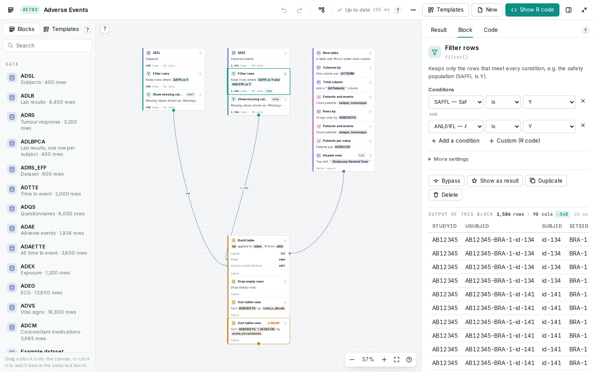
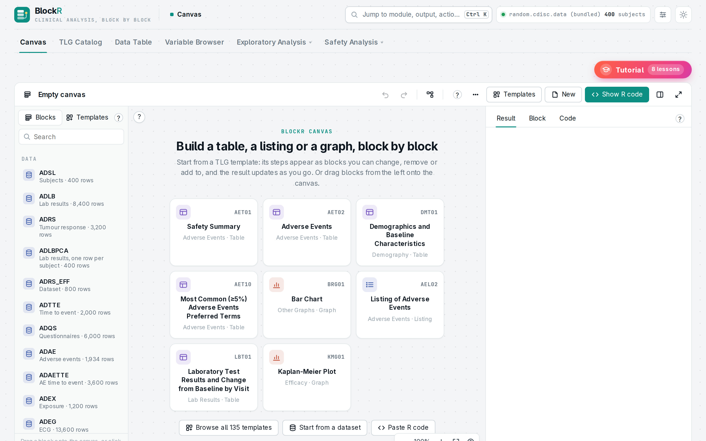
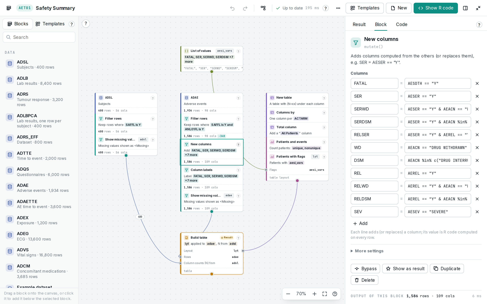
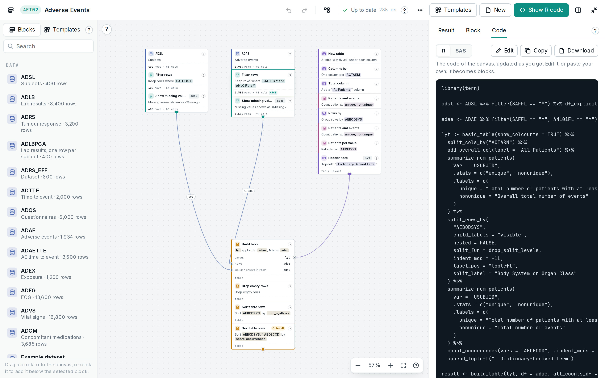
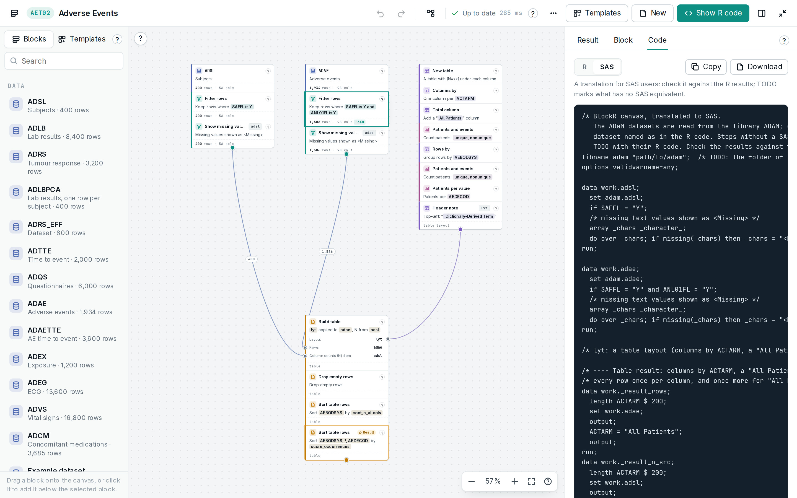
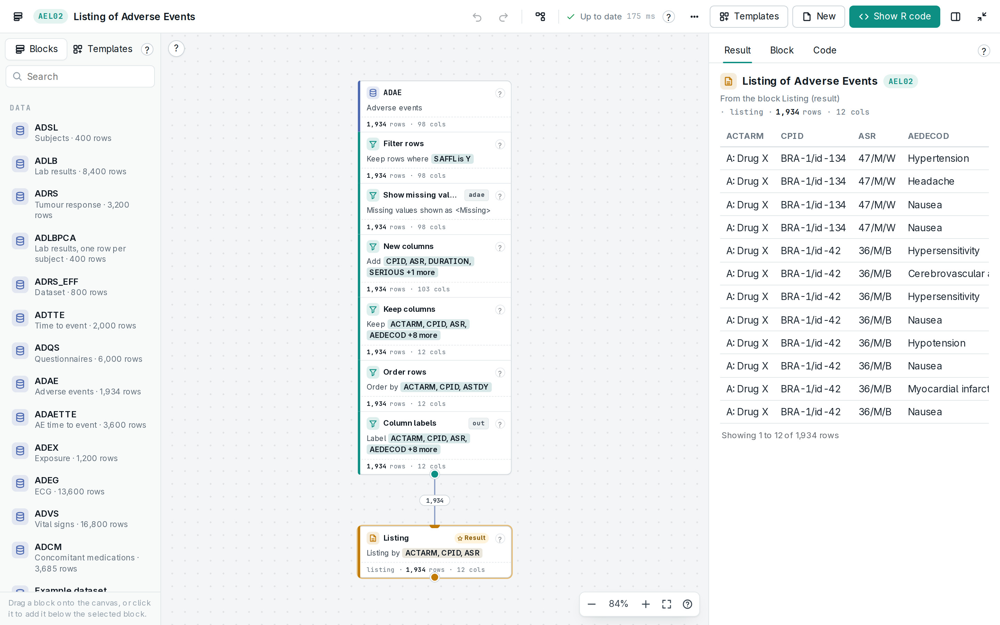
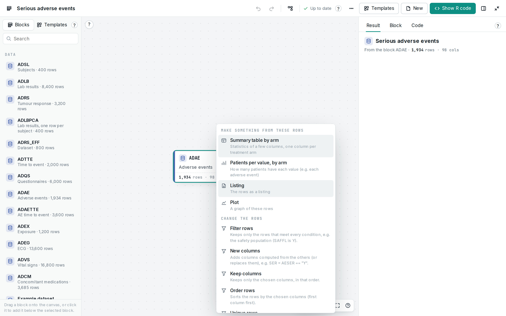
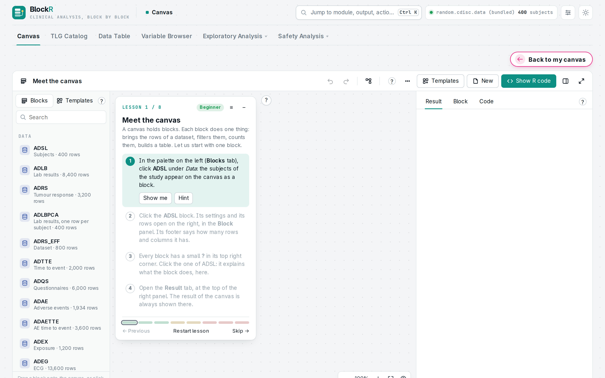
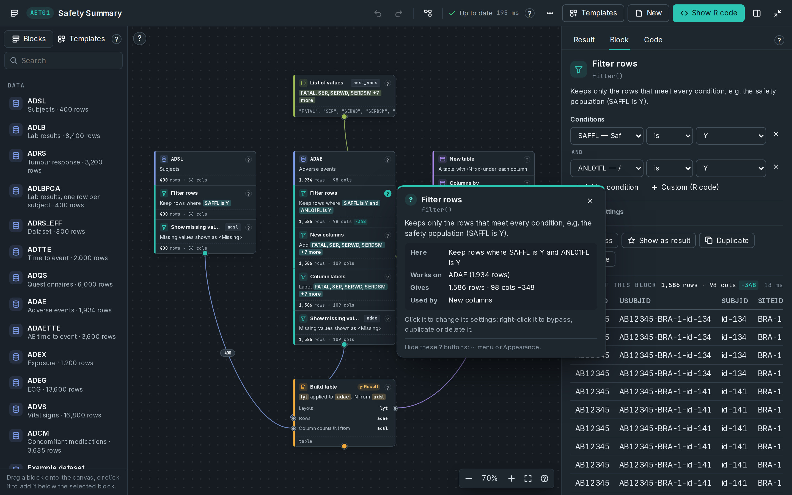

# BlockR: design and delivery

BlockR belongs to the **Neue** framework (minimalist, high-density enterprise) of the Taiga design system. Its dialect: **Instrument canvas, lifted-slate dark**.

- Framework styleguide: [`../../taiga-design-system/neue/STYLEGUIDE.md`](../../taiga-design-system/neue/STYLEGUIDE.md)
- Requirements for new projects: [`../../taiga-design-system/neue/REQUIREMENTS.md`](../../taiga-design-system/neue/REQUIREMENTS.md)
- Delivery model (Shiny · Quarto · HTML): [`../../taiga-design-system/DELIVERY_MODEL.md`](../../taiga-design-system/DELIVERY_MODEL.md)
- Extracted tokens: [`../../taiga-design-system/tokens/BlockR.json`](../../taiga-design-system/tokens/BlockR.json), contrast: [`../../taiga-design-system/tokens/contrast.md`](../../taiga-design-system/tokens/contrast.md)

## Look

teal_neue's token system (`--tn-*`) with a canvas layer (`--bk-*`): stacks of blocks with a category colour (data blue, prep teal, layout violet, analyze plum, output amber, plot terracotta, value olive, code slate), wires coloured by the kind of value they carry, mono row counts, plain-language block summaries, a `?` explanation on every part, and the one loud element, the Tutorial button (`#ff5f45 → #e93d8f → #7b4dff`). Dark mode is the *lifted slate* palette (panels `#1e262e`).

| | |
|---|---|
| Where the look lives | `inst/www/blockr.{css,js}`, `blockr_canvas.{css,js}`, `blockr_tutorial.js`, `R/canvas.R`, `R/blocks_*.R` |
| Token scope | `html:root / [data-bs-theme] (--tn-*) + .bk-app (--bk-*)` |
| Custom properties | 627 |
| `backdrop-filter` / gradients / keyframes | 0 / 8 / 15 |
| Font stacks | `var(--tn-font-mono)`, `var(--bk-mono)` |
| Component namespaces (most used) | `bk`, `tn`, `nav`, `irs`, `shiny`, `btn`, `dt`, `selectize` |

## Feature screenshots

Captured from a **test bench**, not the full running app (no R runtime was available where these were made). The page is built from the app's own unmodified R UI code (run in webR, R compiled to WebAssembly) and its own stylesheets, scripts and fonts. Server results come from the app's own functions where they can run in base R; the rest are stand-ins, listed in `taiga-design-system/VERIFICATION.md`. This is the same kind of bench the project's own `preview/` images were made on.

Files: `docs/features/*.jpg` (2880 × 1800), with titles, captions and provenance in `docs/features/manifest.json`. Regenerate: `python3 taiga-design-system/tools/screens/blockr.py`.

| | |
|---|---|
|  **A template as blocks**: AET02 on the canvas: stacks of blocks wired together, row counts on the wires, the selected filter in plain language. |  **Start**: An empty canvas: featured TLG templates, all 135 templates, or start from a dataset; the block palette on the left. |
|  **Derived columns**: AET01: the New columns block, its eleven derived flags editable as rows, and its output. |  **Show R code**: The canvas as complete, runnable R code, updated as you edit; edit the code and draw it back as blocks. |
|  **SAS translation**: The same canvas as SAS (DATA steps, PROC SQL, PROC REPORT), for SAS users and double programming. |  **A listing**: AEL02: the listing of adverse events as the canvas's result (rows shown from the bundled data). |
|  **What next?**: The + under a stack suggests next steps for its rows, including recipes that add and wire several blocks. |  **Tutorial**: Eight lessons on a canvas of their own, from Meet the canvas to Derive your own column. |
|  **Dark mode**: The lifted slate dark palette; every block explains what it does here, what it works on and what uses it. |  |

## Delivery formats: Shiny · Quarto · HTML

Every Taiga project specifies the triple-format delivery model (one front end, three hosts). Status for BlockR:

| Format | Status | Entry point | What it gives |
|---|---|---|---|
| Shiny | ✓ shipped | `run_app()`, `blockr_app()`, `app.R` | The canvas evaluates blocks on the server, block by block, on the filtered data. |
| Quarto | **specified, not yet built** | planned `blockr_export_quarto(canvas)` | The canvas as a document: one chunk per stack (`blockr_compile()`), block summaries as prose, the SAS translation. |
| HTML | **specified, not yet built** | planned `blockr_export_html(canvas)` | A read-only canvas (the editor runs without Shiny) with the result rendered in. |

The Quarto and HTML formats are specified in the delivery model, with a plan that reuses what the app already has: [`DELIVERY_MODEL.md` §5.1](../../taiga-design-system/DELIVERY_MODEL.md#51-plans-for-the-gaps). Requirements: DLV-01 to DLV-32.

Capability matrix:

| Capability | Shiny | Quarto | HTML |
|---|---|---|---|
| Runs without a server | – | ✓ | ✓ |
| Server-side computation / secrets | ✓ | – | – |
| Persistence across sessions and devices | ✓ | browser only | browser only |
| Author commentary around the tool | – | ✓ | – |
| Works offline / e-mailable | – | with `embed-resources` | ✓ |

